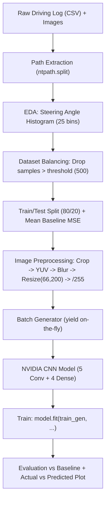
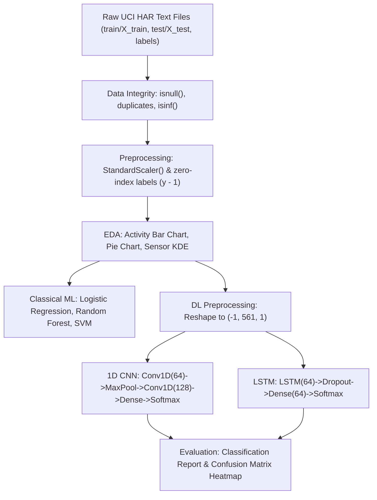

# Deep Learning Applications (DLA) Lab Exam Master Guide

> **Target Audience:** Students preparing for the DLA Lab Internal / External Practical Examination.
> **Format:** Designed specifically for **Paper Writing First (Theory, Architecture, Math & Code on Answer Sheet)** $\rightarrow$ **Followed by System Execution & Viva-Voce**.

---

## Table of Contents

- [PART 1: EXAM STRATEGY & PAPER-WRITING BLUEPRINT](#part-1-exam-strategy--paper-writing-blueprint)
- [PART 2: WEEK 1–4 — SELF-DRIVING CAR STEERING ANGLE REGRESSION](#part-2-week-14--self-driving-car-steering-angle-regression)
  - [a) Problem Definition & Dataset Overview](#a-problem-definition--dataset-overview)
  - [b) Data Understanding & File Structure](#b-data-understanding--file-structure)
  - [c) Telemetry, Images & Path Extraction](#c-telemetry-images--path-extraction)
  - [d) Steering Angle EDA & Dataset Balancing (Histogram Filtering)](#d-steering-angle-eda--dataset-balancing-histogram-filtering)
  - [e) Mean Baseline Model (Benchmark MSE)](#e-mean-baseline-model-benchmark-mse)
  - [f) Regression with Deep Learning](#f-regression-with-deep-learning)
  - [g) Batch Generator (`yield` on-the-fly)](#g-batch-generator-yield-on-the-fly)
  - [h) NVIDIA End-to-End CNN Architecture](#h-nvidia-end-to-end-cnn-architecture)
  - [i) Training the Model](#i-training-the-model)
  - [j) Testing, Evaluation & Visualization](#j-testing-evaluation--visualization)
  - [Paper-Writing Cheat Sheet: Week 1–4 Minimal Complete Script](#paper-writing-cheat-sheet-week-14-minimal-complete-script)
- [PART 3: WEEK 5–8 — HUMAN ACTIVITY RECOGNITION (UCI HAR)](#part-3-week-58--human-activity-recognition-uci-har)
  - [a) Problem Definition](#a-problem-definition)
  - [b) Dataset Understanding (561 Features & 6 Classes)](#b-dataset-understanding-561-features--6-classes)
  - [c) Data Cleaning & Preprocessing (StandardScaler & Zero-Indexing)](#c-data-cleaning--preprocessing-standardscaler--zero-indexing)
  - [d) Univariate EDA (Bar, Pie, KDE Distribution)](#d-univariate-eda-bar-pie-kde-distribution)
  - [e) Classical Machine Learning Classifiers (LR, RF, SVM)](#e-classical-machine-learning-classifiers-lr-rf-svm)
  - [f) Deep Learning Models (1D CNN & LSTM)](#f-deep-learning-models-1d-cnn--lstm)
  - [Paper-Writing Cheat Sheet: Week 5–8 Minimal Complete Script](#paper-writing-cheat-sheet-week-58-minimal-complete-script)
- [PART 4: TOP 30 VIVA-VOCE QUESTIONS & ANSWERS](#part-4-top-30-viva-voce-questions--answers)

---

# PART 1: EXAM STRATEGY & PAPER-WRITING BLUEPRINT

In university lab exams (e.g. VNR VJIET / JNTUH / Autonomous Institutions):
1. **Writing Phase (30–45 mins):** You receive an answer booklet. You must write:
   - Aim / Objective
   - Algorithm / Step-by-Step Flowchart
   - Mathematical Formulations (MSE, ELU, Softmax, Standardization)
   - Neural Network Architecture Diagram (with layer dimensions)
   - Complete, Syntactically Correct Python Code
2. **Execution Phase (30–45 mins):** You log into the system, execute the notebook, show graphs (loss curves, confusion matrix, bar charts), and explain the predictions.
3. **Viva-Voce (5–10 mins):** The examiner asks conceptual questions about layers, activations, loss functions, and preprocessing.

---

# PART 2: WEEK 1–4 — SELF-DRIVING CAR STEERING ANGLE REGRESSION



---

### a) Problem Definition & Dataset Overview
- **Goal:** Predict the continuous **steering angle** (regression) for an autonomous vehicle based on front-facing dash-cam images.
- **Problem Type:** Supervised Regression ($y \in [-1.0, 1.0]$).
- **Dataset:** Udacity Self-Driving Car Simulator data (`driving_log.csv` + `IMG/` directory).
- **Sensors:** 3 camera views (Center, Left, Right) + telemetry (Steering, Throttle, Reverse, Speed).

---

### b) Data Understanding & File Structure

```python
import os
import pandas as pd

# Define columns in driving_log.csv
columns = ['center', 'left', 'right', 'steering', 'throttle', 'reverse', 'speed']
datadir = 'data'

# Load the driving telemetry
dataset = pd.read_csv(os.path.join(datadir, 'driving_log.csv'), names=columns)

print("Dataset size:", len(dataset))
print(dataset.head())
```

**What to remember for paper:**
- 7 columns: `'center', 'left', 'right', 'steering', 'throttle', 'reverse', 'speed'`.
- `names=columns` must be passed because the raw CSV has no header row.

---

### c) Telemetry, Images & Path Extraction

The CSV contains absolute paths from the simulator machine (e.g., `C:\Users\...\IMG\center_xxx.jpg`). We extract only the basename (`center_xxx.jpg`) using `ntpath.split()`.

```python
import ntpath

def removePath(path):
    base, tail = ntpath.split(path)
    return tail

# Clean path for all three cameras
dataset['center'] = dataset['center'].apply(removePath)
dataset['left'] = dataset['left'].apply(removePath)
dataset['right'] = dataset['right'].apply(removePath)
```

**Why `ntpath`?**
- `ntpath` correctly splits Windows backslash (`\`) file paths regardless of the operating system running Python.

---

### d) Steering Angle EDA & Dataset Balancing (Histogram Filtering)

#### Why is balancing required?
In normal track driving, the car travels **straight** most of the time ($\text{steering angle} \approx 0$). Without balancing, the neural network learns a trivial solution: **always predict 0**, causing the car to crash on curves!

```python
import numpy as np
import matplotlib.pyplot as plt
from sklearn.utils import shuffle

# 1. Compute histogram of steering angles
num_bins = 25
hist, bins = np.histogram(dataset['steering'], num_bins)
center = (bins[:-1] + bins[1:]) * 0.5

# 2. Filter out excessive zero-steering samples
threshold = 500
remove_list = []

for i in range(num_bins):
    bin_indices = []
    for j in range(len(dataset['steering'])):
        if dataset['steering'].iloc[j] >= bins[i] and dataset['steering'].iloc[j] <= bins[i + 1]:
            bin_indices.append(j)
    
    bin_indices = shuffle(bin_indices, random_state=42)
    # If a bin exceeds 500 samples, discard the excess
    if len(bin_indices) > threshold:
        remove_list.extend(bin_indices[threshold:])

# Drop excess samples and reset index
dataset = dataset.drop(dataset.index[remove_list]).reset_index(drop=True)
print("Balanced dataset size:", len(dataset))
```

---

### e) Mean Baseline Model (Benchmark MSE)

Before training a complex CNN, we compute a simple statistical baseline: predicting the **mean of the training set** for all test samples. Any useful CNN model **must achieve an MSE significantly lower than this baseline**.

$$\text{Mean Baseline MSE} = \frac{1}{N} \sum_{i=1}^N (y_i - \bar{y}_{\text{train}})^2$$

```python
from sklearn.model_selection import train_test_split

# Extract image paths and steering targets
def loadImageSteering(datadir, dataset):
    imagePath = [os.path.join(datadir, dataset.iloc[i]['center']) for i in range(len(dataset))]
    steeringPath = [float(dataset.iloc[i]['steering']) for i in range(len(dataset))]
    return np.asarray(imagePath), np.asarray(steeringPath)

imagePath, steeringPath = loadImageSteering(os.path.join(datadir, 'IMG'), dataset)

# Train/test split (80% train, 20% test)
x_train, x_test, y_train, y_test = train_test_split(imagePath, steeringPath, test_size=0.2, random_state=6)

# Baseline computation
mean_steering = np.mean(y_train)
baseline_predictions = np.full(len(y_test), mean_steering)
baseline_mse = np.mean((y_test - baseline_predictions) ** 2)

print("Mean Steering:", mean_steering)
print("Baseline MSE:", baseline_mse)
```

---

### f) Regression with Deep Learning: Image Preprocessing Pipeline

Every input image undergoes 5 crucial preprocessing steps:

```python
import cv2

def imagePreprocessing(img_path):
    img = cv2.imread(img_path)
    
    # 1. Crop Region of Interest (remove sky 0:60 and car hood 135:160)
    img = img[60:135, :, :]
    
    # 2. Color space conversion: BGR to YUV (NVIDIA autonomous driving standard)
    img = cv2.cvtColor(img, cv2.COLOR_BGR2YUV)
    
    # 3. Gaussian Blur (removes sensor noise)
    img = cv2.GaussianBlur(img, (3, 3), 0)
    
    # 4. Resize to NVIDIA input dimensions: (width=200, height=66)
    img = cv2.resize(img, (200, 66))
    
    # 5. Normalization [0, 1]
    img = img / 255.0
    return img
```

**Mnemonic to remember the 5 steps:** **C-Y-B-R-N**
- **C**rop `[60:135, :, :]`
- **Y**UV `cv2.COLOR_BGR2YUV`
- **B**lur `cv2.GaussianBlur((3, 3), 0)`
- **R**esize `(200, 66)`
- **N**ormalize `/ 255.0`

---

### g) Batch Generator (`yield` on-the-fly)

#### Why use a generator?
We have thousands of $160 \times 320 \times 3$ images. Loading all preprocessed images into RAM at once would cause an **Out-Of-Memory (OOM)** error. A generator loads and preprocesses **one batch (e.g. 32 images) on the fly** as needed by the GPU/CPU.

```python
def batch_generator(image_paths, steering_values, batch_size=32):
    while True:
        # Shuffle indices every epoch
        indices = np.random.permutation(len(image_paths))
        for start in range(0, len(image_paths), batch_size):
            batch_indices = indices[start:start + batch_size]
            
            images = [imagePreprocessing(image_paths[idx]) for idx in batch_indices]
            steerings = [steering_values[idx] for idx in batch_indices]
            
            yield np.array(images, dtype=np.float32), np.array(steerings, dtype=np.float32)

# Create train and validation generators
batch_size = 32
train_generator = batch_generator(x_train, y_train, batch_size)
validation_generator = batch_generator(x_test, y_test, batch_size)
```

---

### h) NVIDIA End-to-End CNN Architecture

Based on NVIDIA’s landmark paper: *"End to End Learning for Self-Driving Cars"* (Bojarski et al., 2016).

```text
Input (66, 200, 3)
   │
Conv2D (24 filters, 5x5, stride=2, ELU)
   │
Conv2D (36 filters, 5x5, stride=2, ELU)
   │
Conv2D (48 filters, 5x5, stride=2, ELU)
   │
Conv2D (64 filters, 3x3, stride=1, ELU)
   │
Conv2D (64 filters, 3x3, stride=1, ELU)
   │
Dropout (0.5)
   │
Flatten
   │
Dense (100, ELU) -> Dropout (0.5)
   │
Dense (50, ELU)  -> Dropout (0.5)
   │
Dense (10, ELU)  -> Dropout (0.5)
   │
Dense (1, Linear output for regression)
```

#### Code Implementation:
```python
from tensorflow.keras.models import Sequential
from tensorflow.keras.layers import Conv2D, Dense, Dropout, Flatten
from tensorflow.keras.optimizers import Adam

def nvidiaModel():
    model = Sequential([
        # 3 Strided 5x5 Convolutions
        Conv2D(24, (5, 5), strides=(2, 2), input_shape=(66, 200, 3), activation='elu'),
        Conv2D(36, (5, 5), strides=(2, 2), activation='elu'),
        Conv2D(48, (5, 5), strides=(2, 2), activation='elu'),
        
        # 2 Non-strided 3x3 Convolutions
        Conv2D(64, (3, 3), activation='elu'),
        Conv2D(64, (3, 3), activation='elu'),
        Dropout(0.5),
        
        Flatten(),
        
        # Fully Connected Layers with Dropout
        Dense(100, activation='elu'),
        Dropout(0.5),
        Dense(50, activation='elu'),
        Dropout(0.5),
        Dense(10, activation='elu'),
        Dropout(0.5),
        
        # Output: single continuous steering angle
        Dense(1)
    ])
    
    model.compile(optimizer=Adam(learning_rate=1e-3), loss='mse')
    return model

model = nvidiaModel()
model.summary()
```

**Why ELU (Exponential Linear Unit)?**
$$\text{ELU}(x) = \begin{cases} x & \text{if } x > 0 \\ \alpha(e^x - 1) & \text{if } x \le 0 \end{cases}$$
- ELU avoids the "dying ReLU" problem by producing smooth non-zero negative gradients, which is essential for steering regression.

---

### i) Training the Model

```python
steps_per_epoch = len(x_train) // batch_size
validation_steps = len(x_test) // batch_size

history = model.fit(
    train_generator,
    steps_per_epoch=steps_per_epoch,
    epochs=10,  # in exam 3 to 10 epochs is standard
    validation_data=validation_generator,
    validation_steps=validation_steps,
    verbose=1
)
```

---

### j) Testing, Evaluation & Visualization

```python
# 1. Process test images
x_test_processed = np.array([imagePreprocessing(img) for img in x_test], dtype=np.float32)

# 2. Evaluate MSE
test_loss = model.evaluate(x_test_processed, y_test, verbose=0)
print(f"Mean Baseline MSE: {baseline_mse:.4f}")
print(f"NVIDIA CNN Test MSE: {test_loss:.4f}")

# 3. Predict & Compare
predictions = model.predict(x_test_processed, verbose=0).flatten()

# 4. Plot actual vs predicted steering
plt.figure(figsize=(12, 5))
plt.plot(y_test[:100], label='Actual Steering', color='blue')
plt.plot(predictions[:100], label='Predicted Steering', color='red', linestyle='--')
plt.title("Actual vs Predicted Steering Angles (First 100 Test Samples)")
plt.xlabel("Sample Index")
plt.ylabel("Steering Angle")
plt.legend()
plt.grid(True)
plt.show()
```

---

### Paper-Writing Cheat Sheet: Week 1–4 Minimal Complete Script

```python
# ==============================================================
# DLA LAB: WEEKS 1-4 (NVIDIA CNN SELF-DRIVING CAR)
# ==============================================================
import os, ntpath, cv2
import numpy as np
import pandas as pd
import matplotlib.pyplot as plt
from sklearn.utils import shuffle
from sklearn.model_selection import train_test_split
from tensorflow.keras.models import Sequential
from tensorflow.keras.layers import Conv2D, Dense, Dropout, Flatten
from tensorflow.keras.optimizers import Adam

# 1. Load Data
cols = ['center', 'left', 'right', 'steering', 'throttle', 'reverse', 'speed']
df = pd.read_csv('data/driving_log.csv', names=cols)
df['center'] = df['center'].apply(lambda p: ntpath.split(p)[1])

# 2. Balance Steering Angles
hist, bins = np.histogram(df['steering'], 25)
remove_list = []
for i in range(25):
    idx = [j for j in range(len(df)) if bins[i] <= df['steering'].iloc[j] <= bins[i+1]]
    idx = shuffle(idx, random_state=42)
    if len(idx) > 500: remove_list.extend(idx[500:])
df = df.drop(df.index[remove_list]).reset_index(drop=True)

# 3. Image Paths & Split
images = np.array([os.path.join('data/IMG', f) for f in df['center']])
steerings = np.array(df['steering'], dtype=np.float32)
x_tr, x_te, y_tr, y_te = train_test_split(images, steerings, test_size=0.2, random_state=6)

# 4. Preprocessing
def preprocess(p):
    img = cv2.imread(p)[60:135, :, :]
    img = cv2.cvtColor(img, cv2.COLOR_BGR2YUV)
    img = cv2.GaussianBlur(img, (3, 3), 0)
    img = cv2.resize(img, (200, 66))
    return img / 255.0

# 5. Generator
def gen(paths, targets, bsz=32):
    while True:
        idx = np.random.permutation(len(paths))
        for i in range(0, len(paths), bsz):
            b_idx = idx[i:i+bsz]
            X = np.array([preprocess(paths[j]) for j in b_idx], dtype=np.float32)
            y = np.array([targets[j] for j in b_idx], dtype=np.float32)
            yield X, y

# 6. NVIDIA CNN Model
model = Sequential([
    Conv2D(24, (5,5), strides=(2,2), activation='elu', input_shape=(66,200,3)),
    Conv2D(36, (5,5), strides=(2,2), activation='elu'),
    Conv2D(48, (5,5), strides=(2,2), activation='elu'),
    Conv2D(64, (3,3), activation='elu'),
    Conv2D(64, (3,3), activation='elu'),
    Dropout(0.5), Flatten(),
    Dense(100, activation='elu'), Dropout(0.5),
    Dense(50, activation='elu'), Dropout(0.5),
    Dense(10, activation='elu'), Dropout(0.5),
    Dense(1)
])
model.compile(optimizer=Adam(1e-3), loss='mse')

# 7. Train & Evaluate
model.fit(gen(x_tr, y_tr), steps_per_epoch=len(x_tr)//32, epochs=5,
          validation_data=gen(x_te, y_te), validation_steps=len(x_te)//32)
x_te_proc = np.array([preprocess(p) for p in x_te], dtype=np.float32)
print("Test MSE:", model.evaluate(x_te_proc, y_te))
```

---

# PART 3: WEEK 5–8 — HUMAN ACTIVITY RECOGNITION (UCI HAR)



---

### a) Problem Definition
- **Goal:** Classify human physical activity based on triaxial accelerometer and gyroscope data collected from a Samsung Galaxy S II smartphone.
- **Problem Type:** 6-class Multi-Class Classification.
- **Sensor Signals:** Triaxial linear acceleration ($t\text{Acc}$) and triaxial angular velocity ($t\text{Gyro}$) sampled at $50\text{ Hz}$.

---

### b) Dataset Understanding (561 Features & 6 Classes)

The dataset contains pre-engineered 561 feature vectors extracted from time and frequency domains (mean, std, max, min, energy, entropy, etc.).

**The 6 Activity Classes:**
1. `WALKING`
2. `WALKING_UPSTAIRS`
3. `WALKING_DOWNSTAIRS`
4. `SITTING`
5. `STANDING`
6. `LAYING`

#### Loading Data in Python:
```python
import os
import numpy as np
import pandas as pd

data_path = 'har_data/uci-har-dataset-master'

# 1. Load train and test feature vectors (space-separated)
X_train = pd.read_csv(os.path.join(data_path, 'train/X_train.txt'), sep=r'\s+', header=None)
X_test = pd.read_csv(os.path.join(data_path, 'test/X_test.txt'), sep=r'\s+', header=None)

# 2. Load activity labels (1 to 6)
y_train = np.loadtxt(os.path.join(data_path, 'train/y_train.txt'), dtype=int)
y_test = np.loadtxt(os.path.join(data_path, 'test/y_test.txt'), dtype=int)

# 3. Load feature names
feature_names = pd.read_csv(os.path.join(data_path, 'features.txt'), sep=r'\s+', header=None).iloc[:, 1].tolist()
X_train.columns = feature_names
X_test.columns = feature_names

# 4. Activity name mapping
activity_df = pd.read_csv(os.path.join(data_path, 'activity_labels.txt'), sep=r'\s+', header=None, names=['ID', 'Activity'])
activity_names = dict(zip(activity_df['ID'], activity_df['Activity']))

print("X_train shape:", X_train.shape)  # (7352, 561)
print("X_test shape:", X_test.shape)    # (2947, 561)
```

---

### c) Data Cleaning & Preprocessing

```python
from sklearn.preprocessing import StandardScaler

# 1. Data Quality Checks
print("Missing values (train):", X_train.isnull().sum().sum())
print("Missing values (test):", X_test.isnull().sum().sum())
print("Duplicate rows (train):", X_train.duplicated().sum())
print("Infinite values:", np.isinf(X_train.to_numpy()).sum())

# 2. Standardize features to zero mean and unit variance: z = (x - mean) / std
scaler = StandardScaler()
X_train_scaled = scaler.fit_transform(X_train)
X_test_scaled = scaler.transform(X_test)

# 3. Encode labels from 1..6 to 0..5 (required for categorical loss functions)
y_train_encoded = y_train - 1
y_test_encoded = y_test - 1
```

---

### d) Univariate EDA (Bar, Pie, KDE Distribution)

```python
import matplotlib.pyplot as plt
import seaborn as sns

# Map IDs to names for train targets
y_train_named = pd.Series(y_train).map(activity_names)
counts = y_train_named.value_counts()

# 1. Bar Chart
plt.figure(figsize=(9, 4))
sns.barplot(x=counts.index, y=counts.values, palette='viridis')
plt.title("Activity Distribution (Counts)")
plt.xticks(rotation=30)
plt.show()

# 2. Pie Chart
plt.figure(figsize=(6, 6))
plt.pie(counts.values, labels=counts.index, autopct="%1.1f%%", startangle=140)
plt.title("Percentage Distribution of Activities")
plt.show()

# 3. Feature Histogram with KDE
first_feature = feature_names[0]
plt.figure(figsize=(8, 4))
sns.histplot(X_train[first_feature], bins=30, kde=True, color='teal')
plt.title(f"Distribution of {first_feature}")
plt.show()
```

---

### e) Classical Machine Learning Classifiers (LR, RF, SVM)

```python
from sklearn.linear_model import LogisticRegression
from sklearn.ensemble import RandomForestClassifier
from sklearn.svm import SVC
from sklearn.metrics import accuracy_score, classification_report, confusion_matrix

models = {
    "Logistic Regression": LogisticRegression(max_iter=2000),
    "Random Forest": RandomForestClassifier(n_estimators=100, random_state=42),
    "Support Vector Machine (SVM)": SVC(kernel="rbf")
}

for name, model in models.items():
    print(f"\n==================== {name} ====================")
    model.fit(X_train_scaled, y_train_encoded)
    preds = model.predict(X_test_scaled)
    acc = accuracy_score(y_test_encoded, preds)
    print(f"Accuracy: {acc * 100:.2f}%\n")
    print(classification_report(
        y_test_encoded, preds,
        target_names=[activity_names[i] for i in range(1, 7)]
    ))
```

---

### f) Deep Learning Models (1D CNN & LSTM)

#### Reshaping Data for Deep Learning:
Both 1D CNN and LSTM expect input tensors of shape:
$$(\text{batch\_size}, \text{time\_steps}, \text{features}) = (N, 561, 1)$$

```python
from tensorflow.keras.models import Sequential
from tensorflow.keras.layers import Input, Conv1D, MaxPooling1D, Flatten, Dense, Dropout, LSTM
from tensorflow.keras.callbacks import EarlyStopping

# Reshape
X_train_dl = X_train_scaled.astype('float32').reshape(-1, 561, 1)
X_test_dl = X_test_scaled.astype('float32').reshape(-1, 561, 1)
```

#### 1. 1D CNN Architecture:
```python
cnn_model = Sequential([
    Input(shape=(561, 1)),
    Conv1D(64, kernel_size=3, activation='relu'),
    MaxPooling1D(pool_size=2),
    Dropout(0.3),
    
    Conv1D(128, kernel_size=3, activation='relu'),
    MaxPooling1D(pool_size=2),
    Flatten(),
    
    Dense(128, activation='relu'),
    Dropout(0.3),
    Dense(6, activation='softmax')  # 6 classes
])

cnn_model.compile(optimizer='adam', loss='sparse_categorical_crossentropy', metrics=['accuracy'])

early_stop = EarlyStopping(monitor='val_loss', patience=3, restore_best_weights=True)

cnn_history = cnn_model.fit(
    X_train_dl, y_train_encoded,
    validation_split=0.1,
    epochs=10,
    batch_size=64,
    callbacks=[early_stop],
    verbose=1
)

loss, acc = cnn_model.evaluate(X_test_dl, y_test_encoded, verbose=0)
print(f"CNN Test Accuracy: {acc * 100:.2f}%")
```

#### 2. LSTM Architecture:
```python
lstm_model = Sequential([
    Input(shape=(561, 1)),
    LSTM(64),
    Dropout(0.3),
    Dense(64, activation='relu'),
    Dense(6, activation='softmax')
])

lstm_model.compile(optimizer='adam', loss='sparse_categorical_crossentropy', metrics=['accuracy'])

lstm_history = lstm_model.fit(
    X_train_dl, y_train_encoded,
    validation_split=0.1,
    epochs=10,
    batch_size=64,
    callbacks=[early_stop],
    verbose=1
)

loss, acc = lstm_model.evaluate(X_test_dl, y_test_encoded, verbose=0)
print(f"LSTM Test Accuracy: {acc * 100:.2f}%")
```

#### 3. Confusion Matrix Visualization:
```python
cnn_preds = np.argmax(cnn_model.predict(X_test_dl, verbose=0), axis=1)
cm = confusion_matrix(y_test_encoded, cnn_preds)

plt.figure(figsize=(8, 6))
sns.heatmap(
    cm, annot=True, fmt='d', cmap='Blues',
    xticklabels=[activity_names[i] for i in range(1, 7)],
    yticklabels=[activity_names[i] for i in range(1, 7)]
)
plt.title("CNN Confusion Matrix")
plt.xlabel("Predicted Activity")
plt.ylabel("Actual Activity")
plt.xticks(rotation=45)
plt.tight_layout()
plt.show()
```

---

### Paper-Writing Cheat Sheet: Week 5–8 Minimal Complete Script

```python
# ==============================================================
# DLA LAB: WEEKS 5-8 (HUMAN ACTIVITY RECOGNITION - UCI HAR)
# ==============================================================
import os
import numpy as np
import pandas as pd
import matplotlib.pyplot as plt
import seaborn as sns
from sklearn.preprocessing import StandardScaler
from sklearn.linear_model import LogisticRegression
from sklearn.metrics import classification_report, confusion_matrix
from tensorflow.keras.models import Sequential
from tensorflow.keras.layers import Input, Conv1D, MaxPooling1D, Flatten, Dense, Dropout, LSTM

# 1. Load Data
p = 'har_data/uci-har-dataset-master'
X_tr = pd.read_csv(os.path.join(p, 'train/X_train.txt'), sep=r'\s+', header=None)
X_te = pd.read_csv(os.path.join(p, 'test/X_test.txt'), sep=r'\s+', header=None)
y_tr = np.loadtxt(os.path.join(p, 'train/y_train.txt'), dtype=int) - 1
y_te = np.loadtxt(os.path.join(p, 'test/y_test.txt'), dtype=int) - 1

# 2. Scale
scaler = StandardScaler()
X_tr_s = scaler.fit_transform(X_tr)
X_te_s = scaler.transform(X_te)

# 3. Classical ML (Logistic Regression)
lr = LogisticRegression(max_iter=1000)
lr.fit(X_tr_s, y_tr)
print("LR Report:\n", classification_report(y_te, lr.predict(X_te_s)))

# 4. Reshape for DL
X_tr_dl = X_tr_s.astype('float32').reshape(-1, 561, 1)
X_te_dl = X_te_s.astype('float32').reshape(-1, 561, 1)

# 5. 1D CNN
cnn = Sequential([
    Input(shape=(561, 1)),
    Conv1D(64, 3, activation='relu'), MaxPooling1D(2), Dropout(0.3),
    Conv1D(128, 3, activation='relu'), MaxPooling1D(2), Flatten(),
    Dense(128, activation='relu'), Dropout(0.3),
    Dense(6, activation='softmax')
])
cnn.compile(optimizer='adam', loss='sparse_categorical_crossentropy', metrics=['accuracy'])
cnn.fit(X_tr_dl, y_tr, epochs=5, batch_size=64, validation_split=0.1)
print("CNN Test Acc:", cnn.evaluate(X_te_dl, y_te, verbose=0)[1])

# 6. LSTM
lstm = Sequential([
    Input(shape=(561, 1)),
    LSTM(64), Dropout(0.3),
    Dense(64, activation='relu'),
    Dense(6, activation='softmax')
])
lstm.compile(optimizer='adam', loss='sparse_categorical_crossentropy', metrics=['accuracy'])
lstm.fit(X_tr_dl, y_tr, epochs=5, batch_size=64, validation_split=0.1)
print("LSTM Test Acc:", lstm.evaluate(X_te_dl, y_te, verbose=0)[1])
```

---

# PART 4: TOP 30 VIVA-VOCE QUESTIONS & ANSWERS

### Questions on Weeks 1–4 (Self-Driving Car & CNN Regression)

1. **Q: Why is steering angle prediction framed as a regression problem rather than classification?**
   - **A:** Steering angle is a continuous real-valued variable (angles between $-1.0$ and $+1.0$). Binning angles into classes would discard fine-grained control and continuous steering smoothness.

2. **Q: What is the primary cause of class imbalance in autonomous driving data?**
   - **A:** Most human driving on tracks or roads occurs in a straight line ($\text{steering angle} \approx 0$). Sharp turns represent a tiny percentage of the samples.

3. **Q: What happens if you train the CNN without balancing the steering angles?**
   - **A:** The network suffers from "straight-driving bias". It minimizes loss by predicting $\approx 0$ for all frames, which leads to catastrophic failure (driving off-road) at curves.

4. **Q: Why crop the image from row 60 to 135 (`img[60:135, :, :]`)?**
   - **A:** The top region ($0$ to $60$) contains sky, trees, and hills which are irrelevant distractors. The bottom region ($135$ to $160$) contains the car's hood. Cropping isolates the road surface and lane markings.

5. **Q: Why convert the image from BGR to YUV color space?**
   - **A:** In the NVIDIA paper, YUV separates the luminance (brightness/intensity, **Y**) from chrominance (color components, **U** and **V**). Luminance provides essential structural and edge information about road boundaries under varying lighting.

6. **Q: Why apply a Gaussian Blur filter before resizing?**
   - **A:** It acts as a low-pass filter to smooth out high-frequency camera sensor noise and prevent aliasing artifacts during subsequent downsampling.

7. **Q: Why are the first three convolutional layers using stride $(2, 2)$ instead of pooling?**
   - **A:** Strided convolutions allow the network to perform learnable feature downsampling, reducing spatial dimensions while simultaneously learning convolutional filter weights.

8. **Q: Why use ELU (Exponential Linear Unit) activation instead of standard ReLU?**
   - **A:** Standard ReLU sets all negative values to zero ($\max(0, x)$), which can lead to dead neurons. ELU permits negative values ($\alpha(e^x - 1)$), keeping mean activations closer to zero and speeding up regression convergence.

9. **Q: What is the loss function used in the NVIDIA model and why?**
   - **A:** **Mean Squared Error (MSE)**. For regression tasks, MSE heavily penalizes large steering errors, guiding the gradient descent to closely fit actual continuous angles.

10. **Q: What is the purpose of Python generators (`yield`) during model training?**
    - **A:** To prevent loading all thousands of preprocessed image arrays into memory simultaneously (which causes an Out-Of-Memory crash). The generator dynamically loads and augments batches of 32 images on the fly.

11. **Q: What is the Mean Baseline model?**
    - **A:** A trivial statistical model that predicts the average steering angle of the training set for every test sample. Its MSE serves as a sanity check: if the CNN's MSE is not lower than the baseline MSE, the network has not learned meaningful patterns.

12. **Q: What is Dropout and why is a high rate ($0.5$) used?**
    - **A:** Dropout randomly deactivates $50\%$ of neurons during each forward-backward training pass. It forces the network to learn redundant, robust feature representations and prevents overfitting.

13. **Q: What are the input dimensions of the NVIDIA CNN?**
    - **A:** $(66, 200, 3)$ — height $66$, width $200$, and $3$ color channels (YUV).

14. **Q: How many total output neurons does the final layer of the steering model have?**
    - **A:** Exactly $1$ neuron with a linear activation, outputting the predicted steering angle.

15. **Q: Why do we use `ntpath.split` instead of `os.path.split`?**
    - **A:** If driving logs recorded on a Windows machine (using `\` backslashes) are loaded on Linux/macOS, `os.path.split` fails to parse backslashes. `ntpath` guarantees correct Windows-style path splitting across any OS.

---

### Questions on Weeks 5–8 (Human Activity Recognition & DL Classifiers)

16. **Q: What are the 6 target activity classes in the UCI HAR dataset?**
    - **A:** WALKING, WALKING_UPSTAIRS, WALKING_DOWNSTAIRS, SITTING, STANDING, and LAYING.

17. **Q: How many features are present in the UCI HAR dataset?**
    - **A:** $561$ pre-extracted features (statistical metrics over 3-axial accelerometer and gyroscope time windows).

18. **Q: Why do we subtract 1 from target labels (`y - 1`)?**
    - **A:** The raw dataset encodes classes as $1, 2, 3, 4, 5, 6$. Keras and Scikit-Learn require zero-indexed categorical targets ($0, 1, 2, 3, 4, 5$) for sparse categorical cross-entropy loss.

19. **Q: Why is `StandardScaler` applied before training SVM or Logistic Regression?**
    - **A:** Features with large numerical ranges would dominate gradient updates and distance calculations. `StandardScaler` standardizes each feature to have a mean of $0$ and a standard deviation of $1$ ($z = \frac{x - \mu}{\sigma}$).

20. **Q: What is the difference between `Conv2D` and `Conv1D`?**
    - **A:** `Conv2D` slides kernels across two spatial dimensions (height and width of an image). `Conv1D` slides filters across a single sequence dimension (such as time-series sensor vectors or text sequences).

21. **Q: Why reshape the input from `(N, 561)` to `(N, 561, 1)` for 1D CNN and LSTM?**
    - **A:** Keras 1D convolution and recurrent layers require 3D tensors: `(batch_size, sequence_length, channels)`. Here, `sequence_length = 561` and `channels = 1`.

22. **Q: What does LSTM stand for and how does it differ from a standard RNN?**
    - **A:** **Long Short-Term Memory**. It introduces a cell state and three gates (Forget gate, Input gate, Output gate) to regulate information flow, solving the vanishing gradient problem in long sequences.

23. **Q: What is the activation function in the final layer of the HAR classifier?**
    - **A:** **Softmax** activation:
      $$\sigma(z)_i = \frac{e^{z_i}}{\sum_{j=1}^6 e^{z_j}}$$
      It outputs a normalized probability distribution across the 6 activities.

24. **Q: Why is `sparse_categorical_crossentropy` used instead of `categorical_crossentropy`?**
    - **A:** When labels are integer class indices ($0, 1, 2, \dots$), `sparse_categorical_crossentropy` is used. If labels were one-hot encoded vectors ($[1, 0, 0, 0, 0, 0]$), `categorical_crossentropy` would be required.

25. **Q: What is Early Stopping and why is it useful?**
    - **A:** A callback that monitors validation loss and halts training when the loss stops improving for a specified number of epochs (`patience=3`), preventing overfitting and saving training time.

26. **Q: What are the axes in a Confusion Matrix?**
    - **A:** The vertical (Y) axis represents **True / Actual Classes**, and the horizontal (X) axis represents **Predicted Classes**. Diagonal cells represent correct classifications.

27. **Q: Which two activities are most commonly confused by the model in UCI HAR?**
    - **A:** `SITTING` and `STANDING`. Both involve stationary posture with negligible acceleration, resulting in similar sensor magnitude patterns.

28. **Q: What is the difference between Macro Average and Weighted Average in classification metrics?**
    - **A:** **Macro Average** calculates the unweighted mean of the metric across all classes. **Weighted Average** weights the score by the support (number of true instances) of each class.

29. **Q: What is Kernel Trick in SVM?**
    - **A:** A mathematical method (such as RBF: Radial Basis Function) that maps non-linearly separable inputs into a higher-dimensional space where a linear hyperplane can separate the classes, without explicitly computing coordinates in that high-dimensional space.

30. **Q: Why does Random Forest perform well on sensor feature vectors?**
    - **A:** Random Forest is an ensemble of decision trees with bagging (bootstrap aggregation) and random feature subspace selection. It handles non-linear relationships and high feature dimensionality ($561$ features) without suffering from vanishing gradients.
